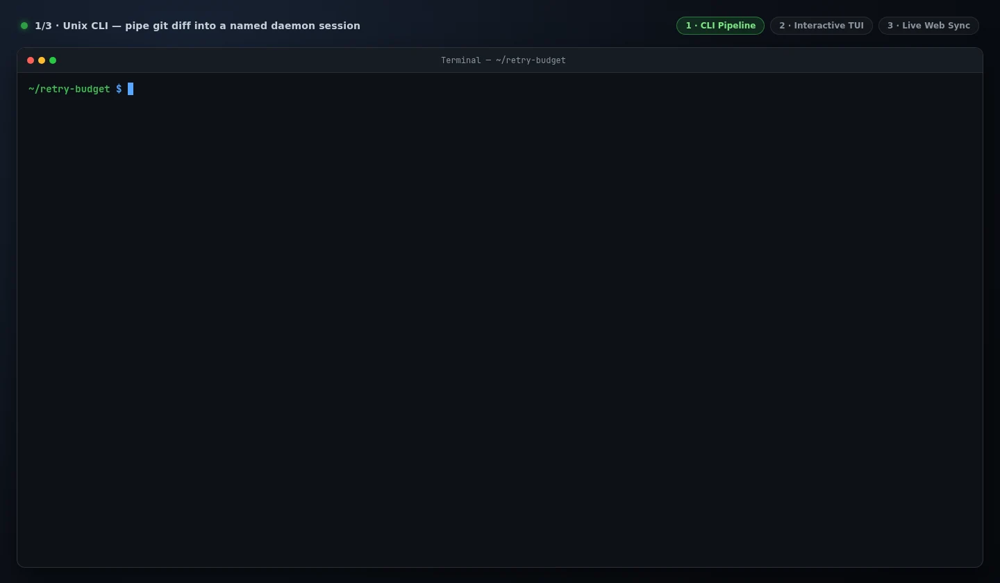

# Plurnk

**The [Bitter Lesson](https://bitterlesson.ai/) applies to the harness, too.**

- **Perpetual Context.** Like a "perpetual stew" for your tokens, Plurnk
  discards compaction entirely in favor of ongoing, model-driven context
  curation.
- **Addressable Memory.** Observations, programs and the model's own reasoning
  keep addresses it can read back and curate; its notes return every
  turn in its own voice.
- **Universal Patterns.** Your entire repo gets indexed on entry, letting the
  model explore and edit the project by regex, XPath, JSONPath, full text, and
  tree-sitter symbols.

Plurnk is an agentic virtual machine: each turn the model writes a short
program, the machine executes it against one address space and journals the
results, and the model reads the journal and writes the next. Files, tools,
delegated sessions, and the model's own past all carry addresses; one selection
algebra reaches every one of them; the edges speak ACPv2, MCP, Agent Skills,
and Agent Plugins. Read the full argument in
[MANIFESTO.md](https://github.com/plurnk/plurnk-service/blob/main/MANIFESTO.md).

This repository provides the Unix CLI and interactive TUI for
[plurnk-service](https://github.com/plurnk/plurnk-service), alongside its
built-in browser interface ([plurnk-web](https://github.com/plurnk/plurnk-web)).
Workspaces, sessions, and history live in the daemon independently of any
attached local or cloud client.



## Get started

Install with the POSIX installer (`git` plus `curl` or `wget`; reuses Node.js 26+
on `PATH` when available, or installs an isolated SHA-256-verified Node.js 26
runtime under `~/.local/share/plurnk/node` without modifying your system Node):

```sh
curl -fsSL https://raw.githubusercontent.com/plurnk/plurnk/main/install.sh | sh
plurnk
```

If you already have Node.js 26+ and npm installed, you can also install via npm:

```sh
npm install -g --ignore-scripts @plurnk/plurnk
plurnk
```

Run from your project directory. Or try it without a global install:
`npx @plurnk/plurnk`.

Give it a task in ordinary language. The model uses the operation language;
you do not need to learn it to use Plurnk. If no model is configured on an
interactive terminal, `plurnk` offers `plurnk onboard` to connect a local
server or provider key and verify a readiness turn, or [choose one below](#models).
The first launch starts the included service, which keeps running for later
sessions ([Service](#service)). Each project folder maps to its own persistent
workspace (`--workspace` and `--session` override). The TUI returns to session
`user` and its history; unless `--session` is given, each one-shot prompt runs
in a new session of its own (reported in `--json` output and on `fd 3` events).

Proposals require review by default (`PLURNK_CLIENT_YOLO=0`); press `Shift+Tab`,
run `/yolo`, or pass `--yolo` to accept them automatically (`? <prompt>` forces
review for one prompt, and `! <command>` runs a shell command directly). Neither
overrides capability restrictions.

## Models

Run `plurnk onboard` for guided first-run model setup, or supply your provider's
API key to the backend—for example, `export DEEPSEEK_API_KEY="your-api-key"`
before launching Plurnk. The service reads environment credentials when it
starts, so export them before the first launch, or restart the daemon
(`plurnk daemon restart`).
In the TUI, `/models` lists models with configured credentials and
`/model <provider/model>` selects one. You can also launch with
`--model=<provider/model>`; aliases are optional.

To set a default for new sessions, add your chosen route to
`~/.config/plurnk/.env` (`$XDG_CONFIG_HOME/plurnk/.env` when set):

```dotenv
PLURNK_MODEL=deepseek/deepseek-v4-flash
```

Reload `.env` changes with `plurnk daemon reload` (or `plurnk daemon restart`
for changed startup listener settings); existing sessions retain their
selection. See [model configuration](https://github.com/plurnk/plurnk-service/blob/main/plurnk-providers/README.md#configure-a-model)
for local endpoints and tuning.

## Service

`plurnk` attaches to the service at `http://127.0.0.1:1066/acp` (`PLURNK_HOST`
and `PLURNK_PORT` move it), starting the installed `plurnk-service` there when
nothing listens. The service keeps running after the client exits and serves
every later session, with one database, `~/.local/share/plurnk/plurnk.db`, and
its log in `~/.local/state/plurnk/service.log`. Manage it with `plurnk daemon <start|stop|restart|reload|status|config>`, and
open the hosted browser interface already signed in with `plurnk web` (or `/web`
in the TUI). Set `PLURNK_ACP_URL` to attach to a remote daemon, and set
`PLURNK_CLIENT_AUTOSTART=0` to disable local autostart.

To start it at login on Linux, install the service package's example [systemd user unit](https://github.com/plurnk/plurnk-service/blob/main/plurnk-core/plurnk.service)
(`plurnk.service` in `@plurnk/plurnk-service`); its comments cover installation,
executable paths, and environment setup. The service must receive your provider
credentials—systemd does not source your interactive shell.

## TUI and CLI

### Interactive terminal

```sh
plurnk
```

A scrollback-native TUI with multiline prompts, streaming reasoning when the
provider supplies it, Markdown and Mermaid rendering, and slash commands for
managing models, sessions, and tools. Run `/help` to explore; `/model` and
`/child` select the session's model and its delegated model, `/learn` distills
reusable workflows from the session into a `SKILL.md`, and `/web` opens the
browser interface.

### CLI and pipelines

```sh
plurnk "Explain how this project's request handling works"
plurnk "Summarize this repository" > overview.md
git diff | plurnk "Review this patch for correctness"
plurnk --json "Explain the test layout" | jq -r .response
```

One-shot commands write the delivered answer to stdout and errors to stderr
(with structured session events on `fd 3` and reasoning on `fd 4` when opened). `--json`
returns one structured document containing the answer, operation trace,
diagnostics, and usage. A lost connection exits with an error while preserving
received evidence; missing final usage stays unknown. No prompt is replayed.

Use `plurnk --help` for CLI options. `plurnk models` lists available model
routes, `plurnk onboard` bootstraps a model route, `plurnk web` opens the web
client, and `plurnk daemon` manages the local daemon.

## Extend and configure

Plurnk uses **ACPv2** for clients, **MCP** for external tools, and **Agent Skills**
for reusable instructions. Tools and skills can be discovered, added, and enabled
per workspace without restarting the daemon: `/mcp discover <query>` searches the
MCP Registry, and `/mcp add <alias> <command|url> [args...]` declares a workspace
server. Standard MCP files, Agent Skills folders, and
[Agent Plugin](https://agent-plugins.org) bundles contribute through the same
configuration cascade. Documentation is retrieved on demand rather than loading
every tool's schema into every prompt.

Configuration uses cascading environment variables and `.env` files, including
the XDG user configuration at `~/.config/plurnk/.env`. Model discovery uses
[models.dev](https://models.dev). Inspect the complete, documented configuration
catalog through the included daemon:

```sh
plurnk daemon config defaults
```

## Documentation

- [Manifesto: An Agentic Virtual Machine](https://github.com/plurnk/plurnk-service/blob/main/MANIFESTO.md)
- [Installation and configuration](https://github.com/plurnk/plurnk-service/blob/main/plurnk-core/INSTALL.md)
- [Browser interface](https://github.com/plurnk/plurnk-web)
- [Architecture and extension points](https://github.com/plurnk/plurnk-service/blob/main/ARCHITECTURE.md)
- [The model-facing language](https://github.com/plurnk/plurnk-service/blob/main/plurnk-contracts/plurnk.md)
- [Client reference](SPEC.md) and [terminal design](TUI.md)

## Contributing

Questions, bug reports, and feedback are welcome in
[GitHub issues](https://github.com/plurnk/plurnk/issues). To show us what
happened, `/share <folder>` (or `--share <folder>` on a run) writes the
workspace's record into that folder. It is unredacted: it holds what
the models saw and wrote, so review it before you attach it. See the shared
[contributing guide](https://github.com/plurnk/plurnk-service/blob/main/CONTRIBUTING.md)
for development guidance.

## License

[MIT](LICENSE).
